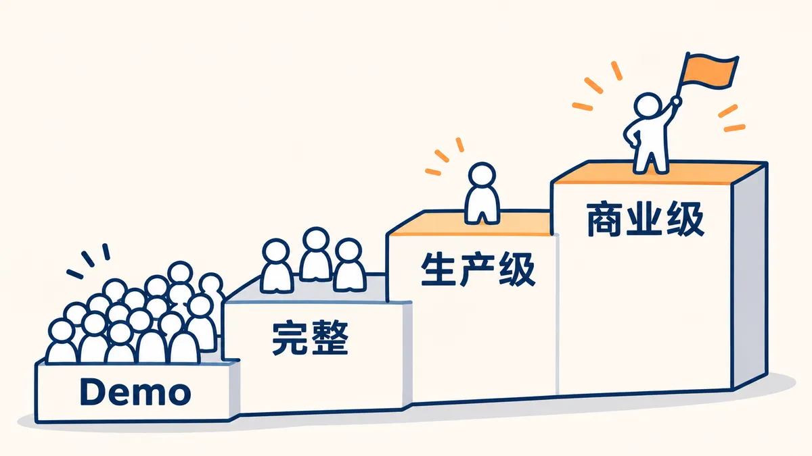

# 从 Demo 到商用

用 AI 编程，把 Demo 做成能收钱、能长期运行的项目。

写给大学生，尤其是还没接触过真实项目的人。课程作业和教程一般只做到 Demo：自己电脑上能跑、能演示。真实项目还要上线、稳定运行、收钱、对账、守住数据和权限、报价和交付，这些课上很少讲。

你需要学过一门语言，跟着教程做过小项目，会用一种 AI 编程助手。不需要先学数据结构和数据库设计。读完以后，你知道每一步该交给 AI 做什么，做完以后自己怎么验收，能把一个能演示的 Demo 一步步做到上线、稳定运行、收钱和交付。

**[在线阅读](https://luochen211.github.io/demo-to-production/)** · **[从序开始](https://luochen211.github.io/demo-to-production/book/preface)**

## 你停在哪一层



| 层次 | 标准 |
| --- | --- |
| Demo | 自己电脑上能演示 |
| 完整 | 功能齐全，能上线给别人用 |
| 生产级 | 上线后一直稳定跑：出事能发现、能恢复，改版时不停机 |
| 商业级 | 有人付钱用：钱算得清，数据和法规守得住，成本算得过来，出错有人负责 |

AI 能很快帮你走到前两层。这本书讲后两层。

## 每章只讲两件事

| 交给 AI 的 | 你要判断和验收的 |
| --- | --- |
| 设计数据、写代码、写测试、配部署、接支付 | 业务对不对、范围怎么取舍、做没做完、线上能不能用、钱算不算得清、出事有没有证据 |

每章给出能直接复制给 AI 的提示词或规则，再给出你要自己检查的项目。全书用一个示例项目贯穿：「餐厅后台」，有菜单、订单、顾客、设置和经营首页五块。

## 目录

目前全部章节是初稿，还在持续修改。

**开篇**

- [序　从一单不到 2000 元的项目讲起](https://luochen211.github.io/demo-to-production/book/preface)
- [第 0 章　你停在哪个层次](https://luochen211.github.io/demo-to-production/book/ch00)

**第一部分　想清楚做什么**

- [第 1 章　Demo 和商用系统差在哪](https://luochen211.github.io/demo-to-production/book/ch01)
- [第 2 章　先弄清业务怎么转](https://luochen211.github.io/demo-to-production/book/ch02)
- [第 3 章　能用现成的就别自己造](https://luochen211.github.io/demo-to-production/book/ch03)

**第二部分　让 AI 把它做出来**

- [第 4 章　把需求拆成 AI 能做、你能验的任务](https://luochen211.github.io/demo-to-production/book/ch04)
- [第 5 章　管住 AI：规则、工作流和审查](https://luochen211.github.io/demo-to-production/book/ch05)
- [第 6 章　什么叫做完了](https://luochen211.github.io/demo-to-production/book/ch06)

**第三部分　上线并稳住**

- [第 7 章　第一天就上线](https://luochen211.github.io/demo-to-production/book/ch07)
- [第 8 章　上线后别出事](https://luochen211.github.io/demo-to-production/book/ch08)

**第四部分　能收钱、担得起责**

- [第 9 章　收钱：支付、退款与对账](https://luochen211.github.io/demo-to-production/book/ch09)
- [第 10 章　守住底线：权限、隐私与合规](https://luochen211.github.io/demo-to-production/book/ch10)
- [第 11 章　算账与运营：成本和经营后台](https://luochen211.github.io/demo-to-production/book/ch11)

**第五部分　和真实世界打交道**

- [第 12 章　报价、排期与需求变更](https://luochen211.github.io/demo-to-production/book/ch12)
- [第 13 章　出事了先找证据](https://luochen211.github.io/demo-to-production/book/ch13)
- [第 14 章　交付、验收与维护](https://luochen211.github.io/demo-to-production/book/ch14)

**附录**

- [附录 A　商用上线前自测清单](https://luochen211.github.io/demo-to-production/book/appendix-a)
- [附录 B　读完以后：去哪找真实项目练手](https://luochen211.github.io/demo-to-production/book/appendix-b)
- [附录 C　术语表](https://luochen211.github.io/demo-to-production/book/appendix-c)

## GitHub 入门小课

书里默认你会用 GitHub。还不会的话，先读这门七节的小课：[GitHub 入门小课](https://luochen211.github.io/demo-to-production/github/)。第 0 课先讲三个核心单位，其他都可以先不知道，这三个一定要知道：Issue 记一件要做的事，PR 交一次改动，GHSA 发一份安全公告。

## 作者

作者 2006 年出生，读民办本科计算机专业，上大学前没写过代码。从一单不到 2000 元的小项目做起，后来给一家上市公司交付了一套陪玩平台，五个端，带在线支付、权限管理和日志审计，在生产环境长期运行。书里的坑大多是他自己踩过的。

## 参与

发现错误或说不清的地方，欢迎提 Issue；想直接改，欢迎提 PR。写法和要求见[共建指南](https://luochen211.github.io/demo-to-production/contribute)。觉得有用，请点个 Star。

## 本地运行

```bash
npm install
npm run dev     # 本地预览，http://localhost:4173
npm run build   # 构建静态站点
```

```text
docs/
  book/            全书章节（序、第 0–14 章、附录）
  github/          GitHub 入门小课
  guide/ delivery/ cases/   参考资料和案例
  public/          图片等静态资源
  .vitepress/      站点配置（config.mts）、目录侧边栏（sidebar.mts）、主题
.github/workflows/deploy.yml   推送到 main 后自动部署到 GitHub Pages
```

## 许可证

MIT
